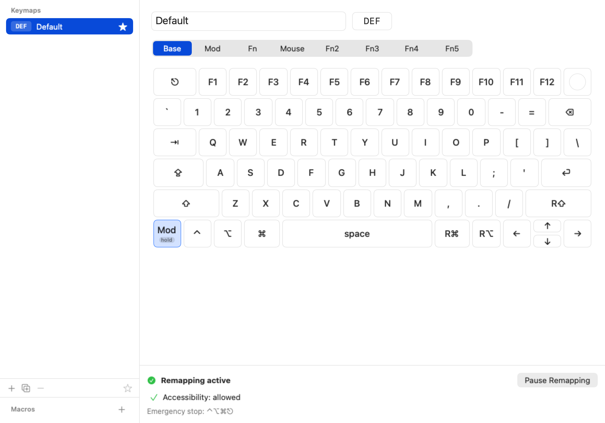
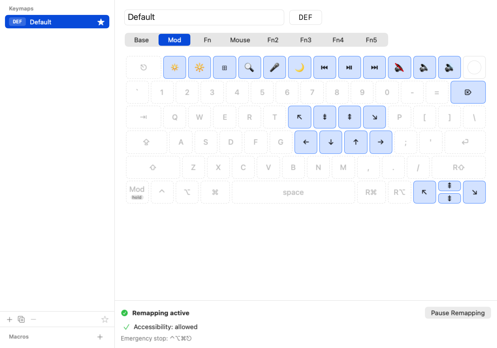

# KeyLayers

KeyLayers is a keyboard remapper for macOS. It adds layers to your keyboard, the built-in MacBook keyboard
included: hold a key and the layer it points to replaces the keys underneath until you let go.

**[Website and setup guide](https://johannes.plunien.com/KeyLayers/)** ·
**[Download](https://github.com/plu/KeyLayers/releases/latest/download/KeyLayers.zip)** (macOS 26 or later)

The starter keymap holds **fn** for the Mod layer: arrows on H J K L, Home, Page Down, Page Up and End on
Y U I O, and the Mac's media keys on F1 to F12.

| Base layer | Mod layer (hold fn) |
| --- | --- |
|  |  |

If remapping gets in your way, press **Left Control + Left Option + Left Command + Escape** to pause it.

## Contributing

Building from source, the architecture, tests and releases are on the website, under
[Contributing](https://johannes.plunien.com/KeyLayers/contributing/). The same pages are in
[`docs/`](docs/).

KeyLayers is released under the [MIT License](LICENSE).
